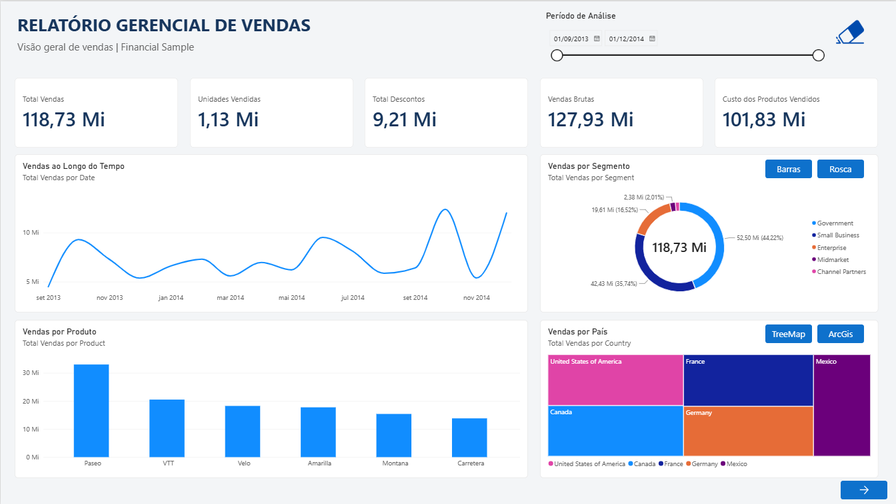
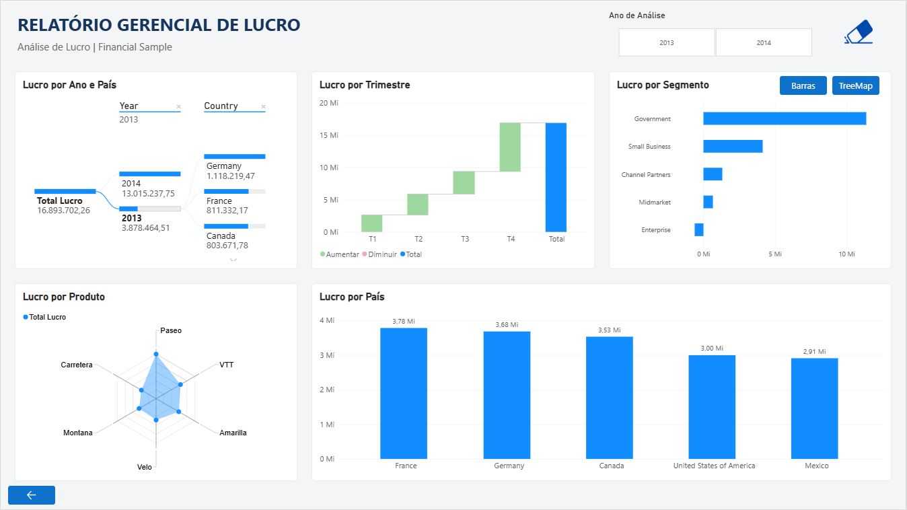

# Relatório Gerencial de Vendas e Lucro no Power BI

> **Módulo 3 - Visualização de Dados e Relatórios com Power BI**
>
> [Voltar à visão geral da Formação Power BI Analyst](../README.md)

Projeto desenvolvido como desafio prático da Formação Power BI Analyst da DIO, com a base Financial Sample e duas páginas de análise. O relatório utiliza segmentadores, navegação e indicadores para alternar entre diferentes visuais sobre o mesmo assunto.

## Objetivo do desafio

Construir um relatório mais elaborado no Power BI Desktop, com estrutura visual definida, botões de navegação, segmentadores e alternância de visuais. Desenvolver uma segunda página, publicar no Power BI Service e disponibilizar a entrega no GitHub.

## Base de dados

O projeto utiliza a amostra Financial Sample, com dados de 2013 e 2014 sobre vendas, unidades, descontos, custos e lucro, organizados por produto, segmento e país.

Fonte de apoio: [repositório da instrutora Juliana Mascarenhas](https://github.com/julianazanelatto/power_bi_analyst).

## Páginas do relatório

### 1. Relatório gerencial de vendas

Apresenta cartões de vendas, unidades vendidas, descontos, vendas brutas e custo dos produtos vendidos. Inclui evolução temporal, vendas por produto, segmento e país, além de segmentador de período.

Os botões permitem alternar entre barras e rosca para segmentos e entre treemap e ArcGIS para países.

### 2. Relatório gerencial de lucro

Apresenta árvore de decomposição por ano e país, gráfico de cascata por trimestre, radar por produto e comparações de lucro por país e segmento. Inclui segmentador de ano e alternância entre barras e treemap por segmento.

## Recursos implementados

- Layout organizado com títulos, cartões e áreas de análise.
- Segmentadores de período e ano.
- Botões com imagem para limpeza dos filtros.
- Navegação entre as duas páginas.
- Indicadores e botões para alternância de visuais.
- Análise geográfica com ArcGIS.
- Árvore de decomposição, cascata e radar.
- Publicação no Power BI Service, com interações conferidas.

## Decisões de visualização

O ArcGIS foi utilizado como alternativa aos visuais de mapa indisponíveis no ambiente de desenvolvimento.

O segmento Enterprise apresenta lucro total negativo. Para permitir sua análise, foi acrescentado um gráfico de barras alternável com o treemap. Na visão geral, a barra à esquerda do zero evidencia o prejuízo. O PDF foi exportado com o gráfico de barras visível.

## Publicação no Power BI Service

[Consultar o relatório no Power BI Service](https://app.powerbi.com/groups/me/reports/a96566f8-51b0-40fb-8063-2da5071ab2cc/b17b226c62dbd9086c03?experience=power-bi).

O relatório foi publicado em Meu workspace. O link depende de autenticação e permissões de acesso. O PBIX e o PDF estão disponíveis abaixo para consulta pelo repositório.

## Arquivos e uso

- [PBIX interativo](dashboard/DesafioM3.pbix): baixar e abrir no Power BI Desktop.
- [PDF com as duas páginas](export/DesafioM3.pdf): consultar a versão estática.
- Prints das páginas na pasta images.

No Power BI Desktop, utilize Ctrl + clique para acionar os botões no modo de edição. O PDF e os prints registram a visualização exportada; as interações estão disponíveis no PBIX e no serviço.

## Aprendizados

O projeto reforçou a seleção de visuais conforme a natureza dos dados, a organização do layout e o uso de indicadores para oferecer diferentes perspectivas de análise. A inclusão do gráfico de barras para Enterprise destacou a importância de representar também os resultados negativos.

## Autoria

**Natasha Sophie Pereira**

Outubro de 2026
