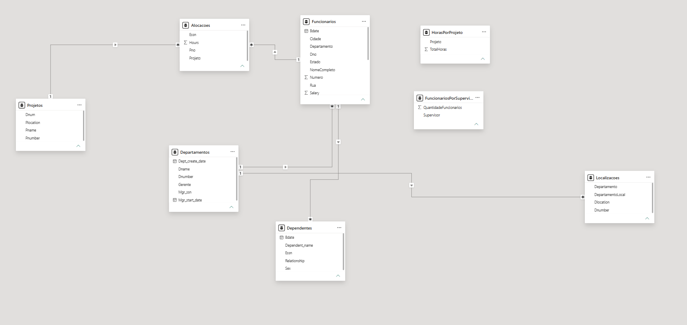
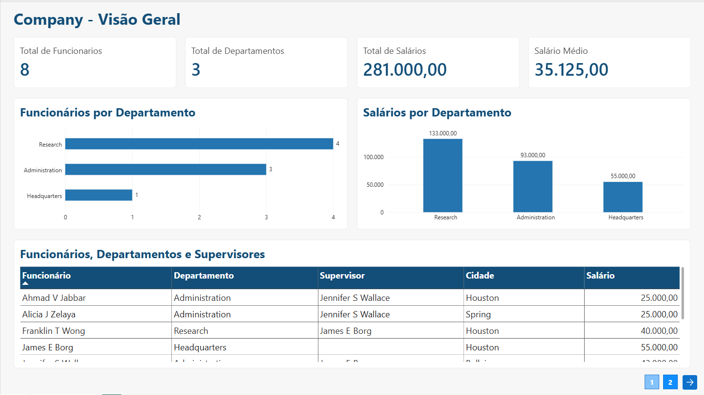
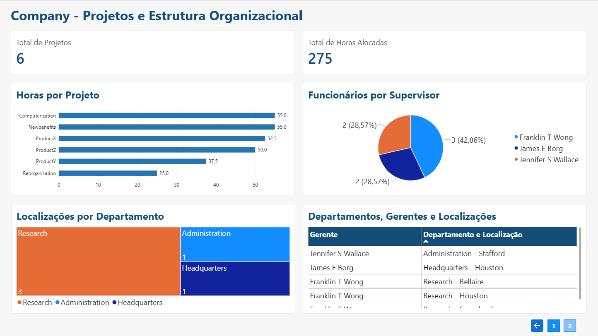

# Processando e Transformando Dados com Power BI

> **Módulo 04 - Processamento de Dados com Power BI**
>
> [Voltar à Formação Power BI Analyst](../README.md)

Projeto desenvolvido para o desafio da Formação Power BI Analyst da DIO. Integra uma base MySQL hospedada na Azure ao Power BI Desktop, com preparação de dados no Power Query e relatório de duas páginas em 1920 × 1080.

## Objetivo e ambiente

Criar uma instância MySQL na Azure, carregar a base Company, conectar o Power BI, verificar a qualidade dos dados e realizar transformações, mesclagens e agrupamentos.

Foi utilizado Azure Database for MySQL Flexible Server, MySQL 8.4, na região West US 2, com conexão SSL e acesso autorizado pelo firewall. O MySQL Workbench foi utilizado para executar os scripts. A base didática foi fornecida no curso; [repositório de apoio da instrutora](https://github.com/julianazanelatto/power_bi_analyst).

## Base e conferência

| Tabela SQL | Consulta no Power BI | Registros |
|---|---|---:|
| employee | Funcionarios | 8 |
| departament | Departamentos | 3 |
| dept_locations | Localizacoes | 5 |
| project | Projetos | 6 |
| works_on | Alocacoes | 16 |
| dependent | Dependentes | 7 |

A grafia `departament` foi preservada para manter compatibilidade com os scripts e a base utilizada.

## Transformações no Power Query

- Renomeação das consultas e remoção das colunas de navegação e campos desnecessários.
- Identificadores de funcionários como texto, códigos de departamentos e projetos como inteiros, datas como data, horas como decimal e salário como decimal fixo.
- Combinação de Fname, Minit e Lname em NomeCompleto, seguida da remoção das colunas originais.
- Separação do endereço em Numero, Rua, Cidade e Estado. A extração pelas extremidades preservou o nome de rua Fire-Oak.
- Mesclagem de Funcionarios com Departamentos por Dno/Dnumber para incluir Departamento.
- Automesclagem dos funcionários por Super_ssn/Ssn para identificar Supervisor.
- Consulta auxiliar independente CadastroGerentes, com Ssn e NomeCompleto, utilizada na mesclagem com Departamentos por Mgr_ssn/Ssn. Sua carga no modelo foi desabilitada e sua independência evitou referência circular.
- Mesclagem de Localizacoes com Departamentos e criação de DepartamentoLocal, combinando departamento e localização.
- Mesclagem de Alocacoes com Projetos por Pno/Pnumber para identificar o nome do projeto.
- Agrupamento de Alocacoes por projeto com soma de Hours, gerando HorasPorProjeto.
- Agrupamento de funcionários com supervisor identificado e contagem de linhas, gerando FuncionariosPorSupervisor.

### Valores nulos e integridade

James E Borg possui Super_ssn nulo porque não tem supervisor cadastrado. O registro foi mantido; não se atribuiu um supervisor fictício. Todos os três departamentos possuem gerente cadastrado. A alocação de James em Reorganization com 0,0 hora também foi preservada.

A inserção respeitou a hierarquia: primeiro o funcionário sem supervisor, depois seus subordinados diretos e, por último, os demais funcionários. Os scripts preservam chaves primárias, estrangeiras e restrições de salário e datas.

### Por que mesclar em vez de acrescentar?

Mesclar relaciona tabelas por chaves e incorpora colunas, permitindo associar funcionários aos departamentos, gerentes e projetos. Acrescentar empilha linhas; não cria essas associações. DepartamentoLocal foi formado pela combinação textual após a mesclagem, identificando os cinco pares departamento/localização.

## Modelo de dados

Relacionamentos ativos de um para muitos, com filtro em uma direção:

| Lado 1 | Lado muitos |
|---|---|
| Departamentos[Dnumber] | Funcionarios[Dno] |
| Departamentos[Dnumber] | Localizacoes[Dnumber] |
| Funcionarios[Ssn] | Alocacoes[Essn] |
| Funcionarios[Ssn] | Dependentes[Essn] |
| Projetos[Pnumber] | Alocacoes[Pno] |

HorasPorProjeto e FuncionariosPorSupervisor são tabelas de resumo sem relacionamentos, utilizadas para apresentar resultados gerais. Esses visuais não recebem filtros das tabelas relacionadas. Não foi criado um segundo caminho de Departamentos até Alocacoes por Projetos, evitando ambiguidade no modelo atual.



## Páginas do relatório

### 1. Company - Visão Geral

Cartões de funcionários, departamentos, total de salários e salário médio; gráficos de funcionários e salários por departamento; tabela de funcionários, departamentos, supervisores, cidades e salários.



### 2. Company - Projetos e Estrutura Organizacional

Cartões de projetos e horas alocadas; barras de horas por projeto; pizza de funcionários por supervisor; treemap de localizações por departamento; tabela de gerentes e DepartamentoLocal.



## Medidas DAX

```dax
Total Funcionarios = COUNTROWS(Funcionarios)
Total Departamentos = COUNTROWS(Departamentos)
Total Projetos = COUNTROWS(Projetos)
Total Horas = SUM(Alocacoes[Hours])
Total Salarios = SUM(Funcionarios[Salary])
Salario Medio = AVERAGE(Funcionarios[Salary])
```

## Resultados conferidos

- 8 funcionários, 3 departamentos, 6 projetos e 275 horas alocadas.
- Total de salários: 281.000,00; salário médio: 35.125,00. A base não informa a moeda, portanto não foi acrescentado símbolo monetário.
- Funcionários: Research 4, Administration 3 e Headquarters 1.
- Salários: Research 133.000,00, Administration 93.000,00 e Headquarters 55.000,00.
- Horas: Computerization 55,0; Newbenefits 55,0; ProductX 52,5; ProductZ 50,0; ProductY 37,5; Reorganization 25,0.
- Subordinados diretos: Franklin T Wong 3, James E Borg 2 e Jennifer S Wallace 2. A pizza considera os 7 funcionários com supervisor, não os 8 funcionários da base.
- Localizações: Research 3, Administration 1 e Headquarters 1. São cinco pares departamento/localização; Houston aparece em dois departamentos.

## Arquivos e reprodução

- [PBIX interativo](dashboard/DesafioM4.pbix).
- [PDF das duas páginas](export/DesafioM4.pdf).
- [Criação das tabelas](data/01_criacao_tabelas.sql).
- [Inserção dos dados e contagens](data/02_insercao_dados.sql).
- [Consultas adicionais de validação](data/03_validacao.sql).
- Imagens das páginas e do modelo na pasta images.

Para reproduzir em MySQL 8 com banco vazio, crie primeiro o schema com `CREATE DATABASE azure_company;`, execute 01_criacao_tabelas.sql e depois 02_insercao_dados.sql. Não execute novamente os scripts de criação e inserção sobre a base já preenchida. O arquivo 03_validacao.sql contém apenas consultas.

Baixe o PBIX e abra no Power BI Desktop para consultar os dados importados. Para atualizar, configure sua própria conexão MySQL, credenciais e acesso de rede em Configurações da fonte de dados. As credenciais de acesso não são fornecidas no repositório.

Os botões de navegação foram testados; no modo de edição do Desktop, utilize Ctrl + clique. As tabelas possuem rolagem no PBIX. O PDF e os prints mostram somente as linhas visíveis na exportação e não possuem interações. A entrega utiliza GitHub, sem depender de publicação no Power BI Service.

## Aprendizados

O projeto consolidou a integração entre banco em nuvem e Power BI, o tratamento de tipos e valores nulos, a diferença entre mesclar e acrescentar, a preservação da granularidade e a criação de agregações. A documentação registra as decisões necessárias para interpretar corretamente os dados.

## Autoria

**Natasha Sophie Pereira**

Outubro de 2026
