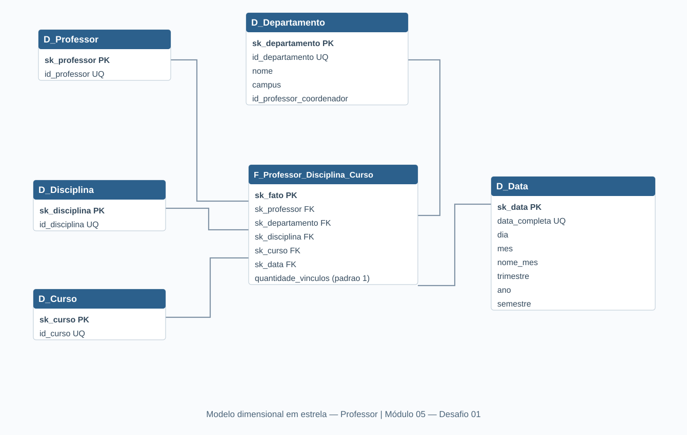

# Desafio 01 — Star Schema da Universidade

> **Módulo 05 — Modelagem de Dados com Power BI**
>
> [Voltar à Formação Power BI Analyst](../../README.md)

Projeto desenvolvido para o primeiro desafio do Módulo 05 da Formação Power BI Analyst da DIO. A atividade consiste em transformar o diagrama relacional de uma universidade em um modelo dimensional do tipo **Star Schema**, tendo **Professor** como foco de análise.

## Objetivo

Representar vínculos entre professores, disciplinas, cursos e departamentos em um esquema dimensional, incorporando uma dimensão temporal hipotética conforme solicitado no desafio. Não foi solicitado desenvolver relatório ou carregar dados reais no Power BI.

## Modelo dimensional

O modelo contém **seis tabelas**: uma tabela fato e cinco dimensões.

| Tabela | Papel | Principais atributos |
|---|---|---|
| `F_Professor_Disciplina_Curso` | Fato | Chaves das dimensões, `sk_fato`, `quantidade_vinculos` |
| `D_Professor` | Dimensão | `sk_professor`, `id_professor` |
| `D_Departamento` | Dimensão | `sk_departamento`, `id_departamento`, `nome`, `campus`, `id_professor_coordenador` |
| `D_Disciplina` | Dimensão | `sk_disciplina`, `id_disciplina` |
| `D_Curso` | Dimensão | `sk_curso`, `id_curso` |
| `D_Data` | Dimensão | `sk_data`, `data_completa`, `dia`, `mes`, `nome_mes`, `trimestre`, `ano`, `semestre` |

As cinco dimensões conectam-se diretamente à tabela fato em relacionamentos **1:N**; não há relacionamentos entre dimensões. Foram adotadas chaves artificiais (`sk_*`) e preservados os identificadores de origem nas dimensões.

## Granularidade, medida e hipóteses

A granularidade proposta é **um vínculo professor–disciplina–curso por oferta acadêmica**. A medida `quantidade_vinculos`, com valor padrão 1 por registro, permite contabilizar vínculos registrados; **não** equivale à contagem distinta de professores.

O diagrama relacional original não apresenta entidade de oferta acadêmica, data de oferta, nome do professor, nome da disciplina ou nome do curso. Por isso:

- `D_Data` foi acrescentada hipoteticamente, representando a **data de início da oferta da disciplina**, para atender ao requisito temporal do desafio;
- o departamento ligado à tabela fato representa o **departamento de vinculação do professor**; o identificador do professor coordenador é preservado como atributo em `D_Departamento`, sem relacionamento dimensão–dimensão;
- a associação disciplina–curso vem da tabela de ligação do modelo original; os vínculos do professor e do departamento dependem das associações originais;
- não foram incluídas as entidades de alunos, matrículas e pré-requisitos, que estão fora do escopo da análise centrada no professor;
- os registros de oferta e suas datas **não são dados observados** da base fornecida; a estrutura é uma proposta de modelagem, sem carga de dados.

**Limitação de implementação:** o modelo de origem não fornece um identificador de oferta. Em uma base real seria preciso definir a identificação das turmas/ofertas e a periodicidade para distinguir ocorrências repetidas da mesma combinação professor–disciplina–curso. Nenhuma unicidade composta de oferta foi imposta à tabela fato.

## Diagrama

## Ferramenta e arquivos

O diagrama foi desenvolvido no [dbdiagram.io](https://dbdiagram.io/), usando **DBML**. A ferramenta foi utilizada para gerar um script de criação de tabelas em **MySQL**. O SQL foi exportado, mas **não foi executado nem validado contra uma instância de banco de dados**.

- [Código-fonte DBML](data/DesafioM5_01_StarSchema_Universidade.dbml) — modelo editável, atributos e relacionamentos;
- [Script SQL para MySQL](data/DesafioM5_01_StarSchema_Universidade.sql) — DDL das tabelas, comentários e chaves estrangeiras;
- [Diagrama vetorial do esquema dimensional (SVG)](images/modelo-star-schema.svg) — visualização reproduzida a partir das tabelas e dos relacionamentos do modelo. A versão PNG original exportada do dbdiagram.io pode ser adicionada posteriormente.

Para reproduzir, abra o código DBML no dbdiagram.io. O SQL pode ser usado como ponto de partida em um banco MySQL vazio; não contém dados ou comandos de inserção.

## Aprendizados

A atividade exercitou a identificação da granularidade de uma tabela fato, a separação entre fatos e dimensões, o desenho de relacionamentos em estrela, o uso de chaves artificiais e a documentação transparente de premissas e limitações ao transformar um modelo transacional em dimensional.

## Autoria

**Natasha Sophie Pereira**

Outubro de 2026
