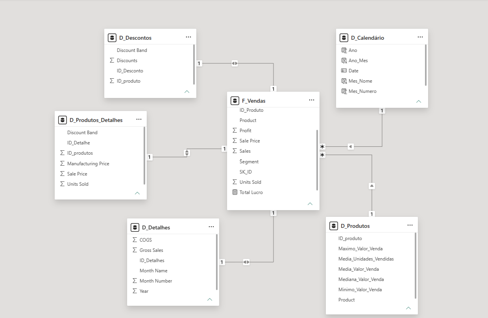
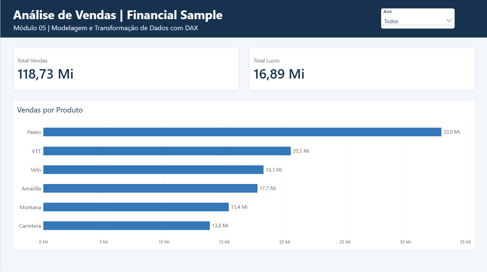

# Desafio 02 — Modelagem e Transformação de Dados com DAX

> **Módulo 05 — Modelagem de Dados com Power BI**
>
> [Voltar à Formação Power BI Analyst](../../README.md) · [Voltar ao Módulo 05](../README.md)

Projeto desenvolvido para o segundo desafio do Módulo 05 da Formação Power BI Analyst da DIO, com base no conjunto de dados **Financial Sample**. A atividade envolve transformações no Power Query, modelagem de tabelas relacionadas e expressões DAX para análise e validação dos resultados.

## Objetivo

Construir um modelo de dados a partir da base **Financial Sample**, utilizando o **Power Query** para preparar, transformar e distribuir os dados em tabelas relacionadas, e **DAX** para criar uma dimensão de calendário e medidas de análise. Uma página de relatório foi desenvolvida para validar o funcionamento dos filtros.

## Base de dados

- Fonte: `Financial Sample.xlsx`, conjunto de dados de exemplo do Power BI.
- Registros de origem: **700**.
- Produtos distintos: **6**.
- Arquivo editável: `DesafioM5-2.pbix`.

## Transformações no Power Query

1. **`Financials_origem`:** importação da planilha, promoção de cabeçalhos, ajuste de tipos, padronização da coluna `Sales` e criação do identificador `ID_Registro_Origem`. Carregamento desabilitado.
2. **`D_Produtos`:** agrupamento por `Product`; inclusão de `ID_produto` e cálculo de média de unidades vendidas, média, mediana, máximo e mínimo do preço de venda. **6 registros**.
3. **`F_Vendas`:** seleção dos campos de vendas e associação à dimensão de produtos por mesclagem. `SK_ID` corresponde ao identificador original do registro. **700 registros**.
4. **`D_Produtos_Detalhes`:** faixa de desconto, preço de venda, unidades vendidas e preço de fabricação, identificados por `ID_Detalhe`. **700 registros**.
5. **`D_Descontos`:** identificação do produto, descontos e faixa de desconto, com a chave `ID_Desconto`. **700 registros**.
6. **`D_Detalhes`:** vendas brutas, custo dos produtos vendidos e atributos de período, com a chave `ID_Detalhes`. **700 registros**.

## DAX

A dimensão de calendário foi gerada com:

```dax
D_Calendário = CALENDAR(MIN(F_Vendas[Date]), MAX(F_Vendas[Date]))
```

Colunas auxiliares:

```dax
Ano = YEAR(D_Calendário[Date])
Mes_Numero = MONTH(D_Calendário[Date])
Mes_Nome = FORMAT(D_Calendário[Date], "MMMM", "pt-BR")
Trimestre = "T" & QUARTER(D_Calendário[Date])
Ano_Mes = FORMAT(D_Calendário[Date], "yyyy-MM")
```

O nome do mês foi ordenado pelo número do mês; a tabela foi marcada como tabela de datas.

Medidas:

```dax
Total Vendas = SUM(F_Vendas[Sales])
Total Lucro = SUM(F_Vendas[Profit])
```

## Relacionamentos do modelo

| Coluna de origem | Coluna relacionada | Cardinalidade | Filtro |
|---|---|---|---|
| `D_Produtos[ID_produto]` | `F_Vendas[ID_Produto]` | 1:* | Único |
| `D_Calendário[Date]` | `F_Vendas[Date]` | 1:* | Único |
| `D_Produtos_Detalhes[ID_Detalhe]` | `F_Vendas[SK_ID]` | 1:1 | Ambos |
| `D_Descontos[ID_Desconto]` | `F_Vendas[SK_ID]` | 1:1 | Ambos |
| `D_Detalhes[ID_Detalhes]` | `F_Vendas[SK_ID]` | 1:1 | Ambos |

Todos os relacionamentos estão ativos.



### Decisão de modelagem e limitações

`D_Produtos` e `D_Calendário` são dimensões em cardinalidade 1:* com a tabela fato. As tabelas `D_Produtos_Detalhes`, `D_Descontos` e `D_Detalhes` preservam a **granularidade de cada registro de venda** e funcionam como **tabelas complementares da fato**, não como dimensões convencionais de um esquema estrela. Os relacionamentos 1:1 bidirecionais atendem à separação dos atributos pedida no exercício, mas podem aumentar a complexidade da filtragem em modelos maiores.

## Relatório de validação

A página **Validação do Modelo** reúne cartões de vendas e lucro, barras de vendas por produto e segmentador de ano. Foram testados os filtros de ano e produto.

Resultados gerais:

- **Total Vendas:** R$ 118.726.350,26 (118,73 Mi).
- **Total Lucro:** R$ 16.893.702,26 (16,89 Mi).



A versão PDF permite visualizar o relatório sem o Power BI Desktop; a interação com filtros requer o `.pbix`.

## Arquivos e reprodução

- [Projeto editável no Power BI Desktop — DesafioM5-2.pbix](DesafioM5-2.pbix).
- [Relatório exportado em PDF — DesafioM5-2.pdf](DesafioM5-2.pdf).
- [Base de dados — Financial Sample.xlsx](Financial%20Sample.xlsx).
- [Imagem do modelo relacional](imagens/modelo_relacional.png).
- [Imagem da página de validação](imagens/validacao_modelo.png).

Para consultar o relatório interativo, baixe o arquivo PBIX e abra-o no **Power BI Desktop**. A página **Validação do Modelo** permite filtrar os indicadores e as vendas por produto pelo ano selecionado. O PDF e as imagens são registros estáticos e não reproduzem as interações.

A base Excel original está incluída para referência e reprodução das transformações. Caso o Power BI solicite atualização da fonte de dados, ajuste o caminho local da planilha nas configurações de origem do Power Query.

## Estrutura dos arquivos

```text
modulo-05-modelagem-dados/
└── desafio-02-modelagem-transformacao-dax/
    ├── README.md
    ├── DesafioM5-2.pbix
    ├── DesafioM5-2.pdf
    ├── Financial Sample.xlsx
    └── imagens/
        ├── modelo_relacional.png
        └── validacao_modelo.png
```

## Aprendizados

- Preparação e transformação de dados no Power Query.
- Criação de chaves, agregação e mesclagem de consultas.
- Dimensão calendário e medidas com DAX.
- Validação de cardinalidades, filtros e resultados.
- Documentação de decisões e limitações de modelagem.

## Autoria

**Natasha Sophie Pereira**

Outubro de 2026
