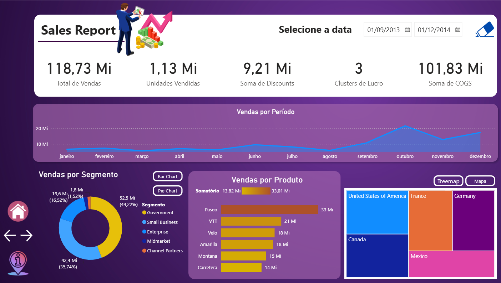
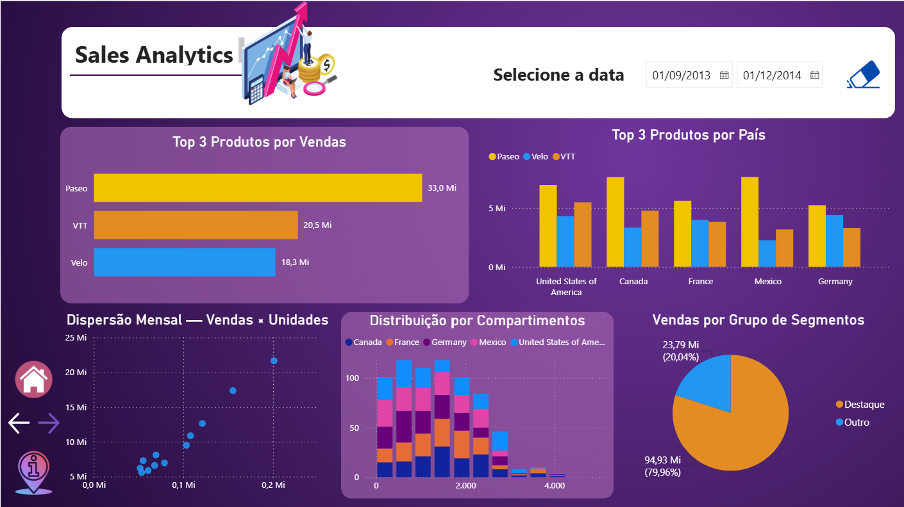

# Desafio 02 — Criando um Relatório de Vendas e Lucros com Data Analytics com Power BI

> **Módulo 06 — Data Analytics e Storytelling com Power BI**  
> [Voltar à Formação Power BI Analyst](../../README.md) · [Voltar ao Módulo 06](../README.md)

Projeto desenvolvido para o segundo desafio do Módulo 06 da **Formação Power BI Analyst da DIO**, com base no relatório `sales_report_desafio_projeto.pbix` disponibilizado pela professora **Juliana Mascarenhas** e no conjunto de dados **Financial Sample**. O objetivo é ampliar o relatório financeiro por meio de análises de **Top N, distribuição, dispersão, agrupamentos e compartimentos (bins)**, organizando os visuais para facilitar a tomada de decisões.

## Requisitos e abordagem

A descrição do desafio orienta criar uma página **Detalhes**, organizar os gráficos conforme a forma de consumo das informações, utilizar as medidas necessárias e distribuir os visuais em até duas páginas adicionais, se preciso. Entre as possibilidades propostas estão: **Top 3 produtos**, principais países em vendas/lucro, dispersão entre unidades e vendas por mês, agrupamentos e compartimentação.

A solução preserva o relatório gerencial da professora e concentra os cinco visuais adicionais em uma única página analítica, **Sales Analytics (Detalhes)**. O estilo original — fundo roxo em gradiente, cartões em tons de roxo, textos claros e ilustrações fornecidas como apoio — foi mantido.

## Páginas do relatório

| Página | Conteúdo e função |
|---|---|
| **Home page** | Capa de abertura do relatório financeiro, com botão **Explorar análise** que leva à navegação analítica. |
| **Principal — Sales Report** | Indicadores de vendas, unidades, descontos, custo dos produtos vendidos e **Clusters de Lucro**; evolução das vendas por período; vendas por segmento e produto; distribuição geográfica, com alternância entre **treemap** e **ArcGIS Map**. |
| **Detalhes — Sales Analytics** | Top 3 produtos em vendas; comparação dos Top 3 por país; dispersão mensal de vendas e unidades; distribuição dos registros por compartimentos de unidades vendidas e país; participação de agrupamentos de segmentos nas vendas. |

A área de trabalho do PBIX de origem também pode conter uma página intitulada **Duplicata de Principal**, utilizada como cópia de edição, que não integra as três páginas apresentadas no PDF final.

## Análises desenvolvidas

### 1. Top 3 Produtos por Vendas

Gráfico de barras horizontais com filtro de **N superior = 3**, classificado por soma de vendas. Na visão geral apresentada, os produtos líderes são:

| Produto | Vendas aproximadas |
|---|---:|
| Paseo | 33,0 Mi |
| VTT | 20,5 Mi |
| Velo | 18,3 Mi |

As cores das séries são reutilizadas no gráfico comparativo por país para manter a consistência visual.

### 2. Top 3 Produtos por País

Gráfico de colunas agrupadas que compara as vendas de **Paseo, Velo e VTT** nos cinco países presentes na base: Estados Unidos, Canadá, França, México e Alemanha. Essa visão permite observar diferenças de participação e desempenho entre produtos e localidades.

### 3. Dispersão Mensal — Vendas × Unidades

Gráfico de dispersão com **unidades vendidas** no eixo horizontal e **vendas** no eixo vertical, agregadas por mês no período selecionado. Permite inspecionar associação entre volume e faturamento, sem pressupor causalidade. Como a base abrange 2013 e 2014, meses de anos diferentes podem estar agregados conforme o filtro.

### 4. Distribuição por Compartimentos

Visual de colunas empilhadas que utiliza a coluna **`Buckets`** criada pela professora a partir de **`Units Sold`**. A configuração original do campo foi verificada no Power BI:

- **Variável:** `Units Sold`.
- **Tipo:** compartimentos numéricos.
- **Valor mínimo:** 200.
- **Valor máximo:** 4.492,5.
- **Número de compartimentos:** 10.
- **Amplitude de cada compartimento:** 429,25.

O eixo horizontal representa intervalos de unidades vendidas; a altura de cada coluna é a **contagem de registros**, discriminada pela legenda **`Country`**. Portanto, o gráfico não representa o total de vendas monetárias por país; ele mostra **como os registros se distribuem entre faixas de quantidade vendida** e como essa composição varia entre países.

### 5. Vendas por Grupo de Segmentos

Gráfico de rosca baseado no campo **`Segmentos agrupados`**, criado por agrupamento categórico:

- **Destaque:** *Government* e *Small Business*.
- **Outro:** demais segmentos.

Na seleção geral mostrada no relatório: **Destaque = 94,93 Mi (79,96%)** e **Outro = 23,79 Mi (20,04%)**. O agrupamento foi definido intencionalmente para comparar um subconjunto de segmentos com os demais; não equivale a agrupamento estatístico automático.

## Clusterização e medida DAX

O modelo disponibilizado pela professora inclui **`Profit (clusters)`**, com três clusters de lucro. A propriedade de clusterização foi inspecionada no Power BI. Na página Principal, um cartão anteriormente redundante de descontos foi substituído pelo indicador **Clusters de Lucro**, que retorna **3** na visão geral.

A medida criada para contar grupos efetivamente presentes, excluindo valores em branco, é:

```dax
Quantidade de Clusters =
CALCULATE(
    DISTINCTCOUNT(financials[Profit (clusters)]),
    financials[Profit (clusters)] <> BLANK()
)
```

O indicador pode variar com os filtros ativos. O campo de clusters é herdado do material de referência; sua identificação no arquivo não significa que um novo algoritmo de clusterização tenha sido desenvolvido neste desafio.

## Navegação, filtros e decisões visuais

- Navegação entre **Home page**, **Principal** e **Detalhes** por botões **Home, Voltar e Avançar**; o botão Avançar da última página foi desabilitado.
- Segmentação por **intervalo de datas** e botão de limpeza, seguindo o padrão do relatório base.
- Na página Principal, alternância de gráficos de segmentos e da visão geográfica por botões e indicadores.
- O visual de mapa tradicional apresentou restrição no ambiente de edição; foi ajustado para **ArcGIS Map**, preservando a opção de alternância com treemap.
- O cabeçalho da página Detalhes foi simplificado para liberar área aos cinco gráficos, sem repetir os cartões gerenciais.
- O layout combina cartões roxos de destaque e visuais sobre fundo transparente, com cores consistentes para os produtos.

## Resultados e limites de interpretação

Os números exibidos nas capturas correspondem ao período apresentado na seleção do relatório, **01/09/2013 a 01/12/2014**, podendo mudar com os filtros. A visão geral mostra aproximadamente **118,73 Mi em vendas** e **1,13 Mi de unidades**.

Os campos **`Buckets`**, **`Segmentos agrupados`** e **`Profit (clusters)`** já estavam presentes no modelo de referência e foram reutilizados nas análises. O cartão de clusters conta categorias não vazias presentes no contexto atual, não registros agrupados nem valores de lucro.

O PDF e as imagens são registros **estáticos**. Para testar filtros, marcadores, mapas e botões, é necessário abrir o arquivo `.pbix` no Power BI Desktop; durante a edição, algumas ações exigem **Ctrl + clique**.

## Prévia das páginas

### Home page — capa


### Principal — Sales Report



### Detalhes — Sales Analytics



## Arquivos do projeto

- [Relatório editável Power BI — DesafioM6-2.pbix](dashboard/DesafioM6-2.pbix)
- [Relatório original da professora — sales_report_desafio_projeto.pbix](dashboard/sales_report_desafio_projeto.pbix)
- [Versão exportada em PDF — DesafioM6-2.pdf](export/DesafioM6-2.pdf)
- [Capa](images/home.png) · [Página Principal](images/principal.png) · [Página Detalhes](images/detalhes.png)

```text
modulo-06-data-analytics-storytelling/
└── desafio-02-data-analytics-vendas-lucros/
    ├── README.md
    ├── dashboard/
    │   ├── DesafioM6-2.pbix
    │   └── sales_report_desafio_projeto.pbix
    ├── export/
    │   └── DesafioM6-2.pdf
    └── images/
        ├── home.png
        ├── principal.png
        └── detalhes.png
```

**Arquivos publicados:** o relatório editável, o PBIX de referência, o PDF e as três capturas de tela estão organizados nas pastas correspondentes. O arquivo da professora é incluído exclusivamente com finalidade educacional e identificação da origem.

## Reprodução e aprendizados

Baixe `DesafioM6-2.pbix` da pasta `dashboard/` e abra-o no **Power BI Desktop**. O projeto demonstra uso de Top N, comparação por país, dispersão, agrupamento de categorias, compartimentos numéricos, medida DAX para clusters, navegação interativa e documentação das escolhas e limitações de interpretação.

## Autoria

**Natasha Sophie Pereira**

Outubro de 2026
